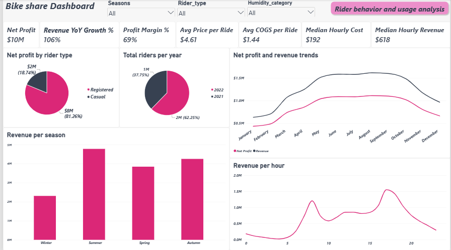
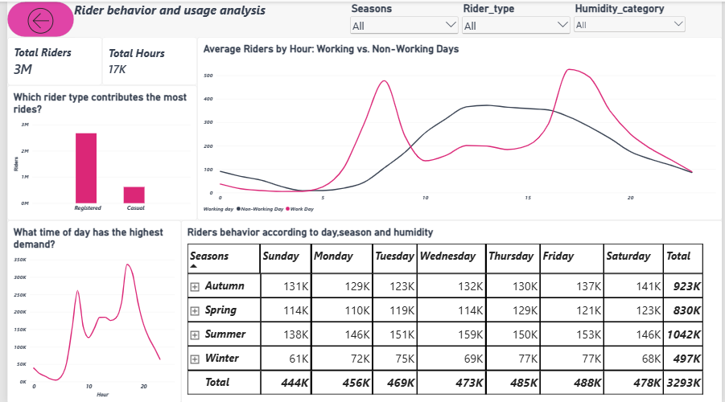

# Bike Share Revenue & Rider Behavior Analysis

## Overview

This project analyzes two years (2021–2022) of hourly bike rental data to understand revenue, profit, and rider behavior. It combines a SQL data model with a two-page Power BI dashboard.

**Key Areas Analyzed:**
- Revenue patterns and trends
- Rider behavior and usage patterns
- Factors influencing rider demand

## Data Sources

| File | Description |
|---|---|
| `bike_share_yr_0.csv` | Hourly rental records, year 1 (2021) |
| `bike_share_yr_1.csv` | Hourly rental records, year 2 (2022) |
| `cost_table.csv` | Price and COGS per rider, by year |

Each hourly record is split into two rows per rider type (`registered`, `casual`).

## Data Model (SQL)

A single view, `bike`, unions both years and joins in price/COGS by year:

```sql
with bike as (
select *
from bike_share_0
	union all
select *
from bike_share_yr_1
)
select
	bike.date_day as date_day,
	bike.season,
	bike.yr as year,
	bike.mnth as month,
	bike.hr as hour,
	bike.holiday,
	bike.weekday,
	bike.workingday as working_day,
	bike.weather_situation as weather_situation,
	bike.temperature as temperature,
	bike.atemperature as apparent_temperature,
	bike.humidity as humidity,
	bike.wind_speed as wind_speed,
	bike.rider_type,
	bike.riders,
	costa.price,
	costa.cogs
from bike
	left join costa
		on bike.yr = costa.yr;
```

All downstream analysis queries (hourly revenue, profit trends, seasonal revenue, rider behavior by weather/temperature/humidity/wind/holiday) select from this view. See `queries.sql` for the full set.

### Key calculations
- **Revenue** = `riders * price`
- **Profit** = `riders * (price - cogs)`
- **Temperature (°C)** = `temperature * 47 - 8`
- **Season** = derived from calendar month (Dec–Feb = Winter, Mar–May = Spring, Jun–Aug = Summer, Sep–Nov = Autumn), not the dataset's own `season` code, which uses a different boundary
- **Rate-based metrics** (riders per hour by weather/temperature/humidity/wind) are calculated as `sum(riders) / count(distinct (date_day, hour))`, not raw totals, since weather categories don't cover an equal number of hours

## Dashboard


**Page 1 — Overview.** This page tracks the financial performance of the bike-share business, showing net profit, revenue growth, margin, and pricing alongside breakdowns by rider type, year, season, and hour. The goal is to answer how much money the business is making and where it comes from.


**Page 2 — Rider Behavior and Usage Analysis.** This page shifts from money to usage patterns, showing when riders are most active and how demand varies by working day, weekday, season, and humidity. The goal is to answer when and under what conditions people ride.

Both pages share the same Season, Rider Type, and Humidity Category slicers, so filtering on one carries across both.

## Key Findings

- Revenue grew ~106% year over year ($4.96M → $10.23M); profit grew similarly ($3.42M → $7.03M)
- Registered riders account for ~81% of net profit
- Summer is the highest-revenue season; Winter the lowest
- Working days show sharp commute peaks (~478 riders/hr at 8am, ~526 at 5pm); non-working days peak midday (~373 riders/hr around 1pm)
- Ridership rises steadily with temperature (Freezing ≈ 57 riders/hr up to Hot ≈ 326 riders/hr)
- Weather has a moderate effect on ridership; clear conditions outperform misty ones by roughly 1.2x per hour, not the 3x suggested by raw totals

## Known Limitations

- **Weekday coding does not match real calendar dates.** The dataset's `weekday` field is internally consistent but doesn't align with the actual dates in `date_day`. Day-of-week results reflect the dataset's own coding, not the true calendar.
- **44 hourly records have humidity = 0**, which is a sensor error rather than a real "very dry" reading. These are included in the "Very Dry" bucket.
- **Revenue assumes each rider count is one paid ride** at that year's flat price; the dataset does not confirm this directly.
- **Weather category "Heavy Rain/Snow" has very little data** (only a few hours), so results for that bucket should be treated as low-confidence.
- Season bars/matrix rows are displayed in a fixed (non-calendar) order in the current dashboard build; this is a cosmetic choice, not a data issue.

## Files

- `Bike.sql` — all SQL views and analysis queries
- `bike_share_yr_0.csv`, `bike_share_yr_1.csv`, `cost_table.csv` — source data
- Power BI dashboard (`.pbix`)
